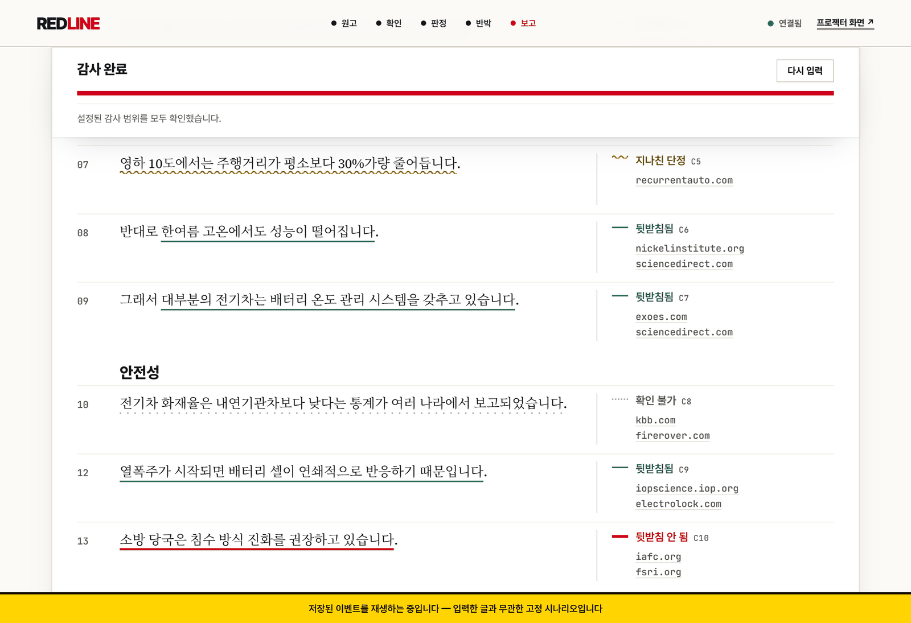

# REDLINE

REDLINE checks the factual claims in AI-written text sentence by sentence and marks each verdict in the margin, for people who rely on a model's answer or have to review a draft a model wrote.

The Python host that runs the agent issues an evidence ID for every result a search or page fetch returns, and the tool that records a verdict accepts only those IDs, so a source the agent never retrieved cannot be recorded.



*A saved live run from 2026-08-01 on a Korean text about EV batteries, replayed with `python server.py --mock`. Margin labels, top to bottom: overstated, supported, supported, could not check, supported, unsupported. The yellow banner says the screen is a replay.*

REDLINE was a solo entry to AGENT:24, a 24-hour hackathon run by YAI, Yonsei University's AI society, in Seoul on 2026-08-01 and 08-02 (Liner API track). It is a prototype, version 0.1.0. In one live run on 2026-08-01 it picked 14 claims from a 19-sentence Korean text and checked all of them in 71.5 s of its 90 s timebox.

## What it does

- Takes up to 2,000 characters of pasted text in Korean or English. The host splits it into sentences, and the model picks up to 14 claims to check. A claim is a sentence, or part of one, that states a checkable fact.
- Checks each claim in up to three steps, cheapest first: does a source for it exist, does that source say what the sentence says, and is there counter-evidence the text leaves out. The agent fetches a page or PDF when a search snippet is not enough to compare.
- Marks each checked sentence in the margin as supported, unsupported, overstated, source not found or could not check, with links to the search results the verdict cites.
- Lists the counter-evidence and suggested rewrites in separate tabs, and streams every raw tool call to a second page (`/raw`) for projection during a live demo.

## How it works

The model classifies the input, picks claims, compares sources and proposes verdicts through seven tools. The host (the Python code in `core/`) records them and owns the state: the sentence list, the evidence ledger, the search log and the rules for when a run counts as complete.

- Evidence IDs. Every search or fetch result enters a ledger and gets an ID such as `E7` (`Audit.register_evidence` in `core/audit.py`). The verdict tool `update_verdict` takes `evidence_ids` and has no field for a URL or title. The host rejects IDs that are not in the ledger and IDs that came from a search made for another claim, and the source links in the margin notes and on the counter-evidence cards come from the ledger (`test_unknown_evidence_id_is_rejected_with_catalog`, `test_another_claims_evidence_cannot_close_this_claim` in `core/test_audit.py`).
- Search stance. `search_web` and `search_scholar` require a `stance` of `support` or `challenge`. `Audit.completion_report()` labels a run `complete` only if every audited claim, except those closed by a failed source check, got a support search and a challenge search with different queries. Each tool reply shows the model how many challenge searches it has made, but not how many are required (`test_budget_envelope_hides_the_challenge_quota` in `core/test_agent.py`).
- Cheap checks first. `update_verdict` rejects a content verdict for a claim that has no source verdict yet, and a failed source check closes the claim. Page fetches, the slowest call, are refused after 60% of the 90 s timebox (`test_axis_order_violation_is_rejected_with_recovery_path`, `test_fetch_is_refused_after_the_cutoff`).
- Verdict rules. The host derives each label from the check outcomes (`decide_verdict` in `core/audit.py`). A failed source check is stored as "source not found" and cannot become "unsupported". Only the content check can mark a claim unsupported or overstated; counter-evidence goes to its own panel and leaves the label as it was (`test_axis1_fail_is_always_no_source`).
- Host-owned sentences. `record_claim` rejects a claim whose quoted text is not in the sentence it points to and returns candidate positions, so each margin mark sits on the sentence the claim came from (`test_mismatched_coordinate_is_rejected_and_correctable`).

The agent loop runs on the OpenAI Agents SDK (`openai-agents`). Search goes to Liner's web and scholarly search APIs over `httpx`, which also fetches pages; `trafilatura` and `pypdf` extract the text of HTML pages and PDFs. `server.py` relays the run to the browser over a FastAPI and uvicorn WebSocket, and the UI in `ui/` is plain HTML, CSS and JavaScript.

Start reading here: `core/agent.py` (the run loop, 416 lines), `core/model_tools.py` (the seven tools and the budget) and `core/audit.py` (ledger and completion rules; large at 1,740 lines, 88 KB).

## Results

Four live runs on 2026-08-01 with the OpenAI and Liner APIs. These are local measurements by the author. The first two ran under an earlier demo setting with a 110 s timebox. The product now gives every input 90 s and at most 14 claims.

| Input | Timebox | End state | Time | Claims | Counter-evidence found | Support : challenge searches |
|---|---|---|---|---|---|---|
| English health text, 4 sentences | 110 s | complete | 38.3 s | 4 | 1 | 3 : 3 |
| English text written with care, 3 sentences | 110 s | complete | 41.2 s | 3 | 3 | 4 : 4 |
| Korean economics text | 90 s | complete | 30.0 s | 4 | 2 | 3 : 4 |
| Korean mixed text, 19 sentences | 90 s | complete | 71.5 s | 14 | 6 | 14 : 14 |

- No existing source was marked "source not found" in these runs. All three claims of the carefully written English text passed the source and content checks, and the counter-evidence found for them left their verdicts unchanged.
- The 14-claim cap was worked back from the timebox: a measured base of 27 s plus about 3.2 s per claim. The longest input finished in 71.5 s, 19 s inside the limit.
- Search results change between runs, so these numbers move. They were measured on the build of 2026-08-01. The completion rules and the binding of evidence to claims were tightened on 2026-08-02, and the live runs have not been repeated since.

## Status and limitations

- Prototype, version 0.1.0. Accuracy has not been measured on a labeled set, and each row in the table above is a single live run.
- The evidence-ID check covers the sources that verdicts and counter-evidence cards cite. The host does not check the model's own wording: the one-sentence explanation recorded with each verdict, the summary on each counter-evidence card and the final report. A link the model writes into a card summary or the final report is shown as a clickable link, whether or not a search returned it.
- Live runs need an OpenAI API key and a Liner API key, and both are paid APIs. Without `LINER_API_KEY`, or with `LINER_MOCK=1`, search reads saved fixtures and the screen says so.
- The interface is in Korean, and the model writes its final report in Korean, also for English input.
- One audit covers at most 2,000 characters and 14 claims in 90 s. In longer texts some sentences go unchecked; the coverage figure counts them and the screen lists them.
- A claim is anchored to one sentence, so a claim that spans two sentences keeps its second half only in the explanation. A claim registered by mistake cannot be withdrawn; the model closes it as "could not check".
- Page fetches do not get past paywalls or robot blocks. The prompt then has the model judge from the search snippet, or record "could not check" when it cannot see the content; the host does not enforce this. Scholarly search is limited to 2 requests per second. Retracted papers are not tracked.
- The audited text and fetched pages reach the model inside marked data blocks (`wrap_input` in `core/agent.py`, `fence_fetched_body` in `core/model_tools.py`). This is a prompt-level guard against injected instructions; the evidence-ID checks run in the host and do not depend on it.
- Dependencies are not pinned in `pyproject.toml`. CI runs the offline suite, with a fake model and fixture search, on Python 3.11 and 3.13. On 2026-10-31 the suite had 529 tests and passed locally with openai-agents 0.24.0.

## Run it

Python 3.11 or newer. These commands need no API key.

```bash
git clone https://github.com/dnhynk/redline.git && cd redline
python3 -m venv .venv && . .venv/bin/activate   # Windows: py -m venv .venv, then .venv\Scripts\activate
pip install -e ".[dev]"
python server.py --mock                         # then open http://127.0.0.1:8486/
python -m pytest -q                             # expected: 529 passed in under a minute
                                                # (528 passed, 1 skipped without Node.js)
```

In the browser, paste any text and press the button under the text box (감사 시작, "start audit"). The server ignores the input and replays the saved run shown above; `--speed 3` plays it faster, and `/raw` shows the same run as raw tool calls.

For a live audit, copy `.env.example` to `.env`, set `OPENAI_API_KEY` and `LINER_API_KEY`, and run `python server.py`. `python main.py --file text.txt` runs one audit in the terminal. The default model is `gpt-5.6-terra`; set `TRACER_MODEL` to use another.

## Docs

- [`prompts/system.md`](prompts/system.md): the agent's instructions and audit rules (in Korean, 532 lines).
- [`test_contract_drift.py`](test_contract_drift.py): golden tests that pin the seven tool schemas and the list of end states.
- [`ui/slides.html`](ui/slides.html): the five-slide hackathon pitch (in Korean; the server serves it at `/ui/slides.html`).
- [`.env.example`](.env.example): environment variables.
- [`ui/fonts/LICENSES.md`](ui/fonts/LICENSES.md): the bundled fonts and their licenses.

## Project context

Specified, reviewed and verified by me; implemented with AI coding agents such as Claude Code.

## License

Code: MIT ([LICENSE](LICENSE)). The fonts in `ui/fonts/` are under the SIL Open Font License 1.1 ([OFL.txt](ui/fonts/OFL.txt)).
